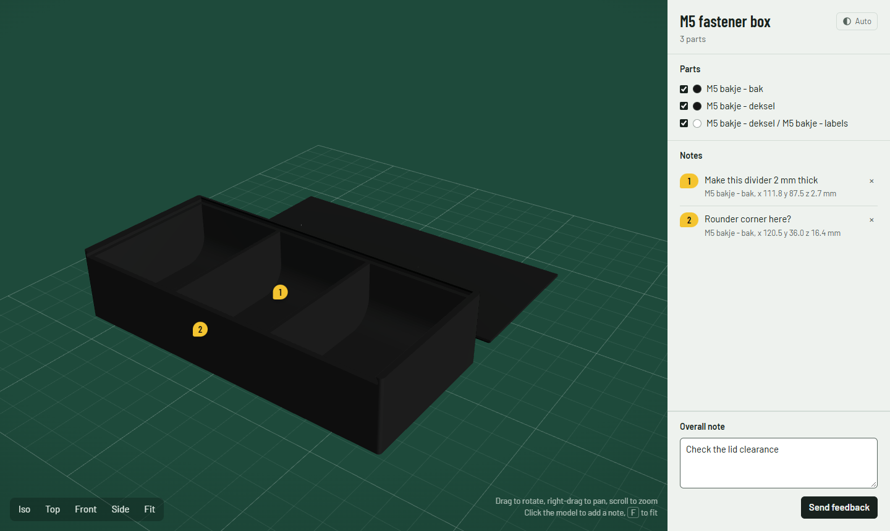

# Model Review MCP

Review 3D models with your AI assistant by pointing at them. The assistant opens a model in a browser viewer, you click the exact spot you mean, write what should change and press **Send feedback**. The assistant gets every note with the part name, the position in millimetres, the surface direction and a screenshot with numbered pins.

Built for 3D printing: STL, 3MF and Bambu Studio / OrcaSlicer projects, with part names, plate positions and filament colours intact. Works with any MCP client, including Claude Code, Claude Desktop, Cursor, VS Code, Windsurf and Codex.



## Quick start

You need [uv](https://docs.astral.sh/uv/getting-started/installation/). The server runs straight from GitHub; there is nothing to clone.

**Claude Code**

```sh
claude mcp add model-review -s user -- uvx --from git+https://github.com/Rovey/model-review-mcp model-review-mcp
```

**Claude Desktop, Cursor, Windsurf** and other clients with a JSON config:

```json
{
  "mcpServers": {
    "model-review": {
      "command": "uvx",
      "args": ["--from", "git+https://github.com/Rovey/model-review-mcp", "model-review-mcp"]
    }
  }
}
```

VS Code uses the same entry under `"servers"` instead of `"mcpServers"`.

**Codex** (`~/.codex/config.toml`):

```toml
[mcp_servers.model-review]
command = "uvx"
args = ["--from", "git+https://github.com/Rovey/model-review-mcp", "model-review-mcp"]
```

Restart the client, then ask your assistant something like *"show me box.3mf so I can mark what to change"*.

## How a review works

1. The assistant calls `review_show_model` with one or more files. A browser tab opens, or an open one reloads.
2. You rotate the model and click wherever something should change. Type a note and press Enter. Each note gets a numbered tag.
3. You press **Send feedback**.
4. The assistant reads your notes and screenshots, changes the design and can show the new version in the same tab.

## Tools

### `review_show_model`

Opens model files in the viewer. Calling it again replaces the model.

| Parameter | Type | Description |
|---|---|---|
| `paths` | list of strings, 1–20 | Absolute paths to `.stl`, `.3mf`, `.obj`, `.ply`, `.glb` or `.off` files. Several files are laid out side by side, 20 mm apart. |
| `title` | string, optional | Heading shown in the viewer. Defaults to the file names. |

### `review_get_feedback`

Returns the notes from the last time the user pressed Send feedback.

| Parameter | Type | Description |
|---|---|---|
| `wait` | boolean, default `false` | Block until the user sends feedback. |
| `timeout_s` | integer 1–3600, default `600` | Maximum wait in seconds. |

Example result:

```json
{
  "model": "M5 fastener box",
  "overall": "Check the lid clearance",
  "view": "~/.model-review/reviews/20261014-120501/view.jpg",
  "notes": [
    {
      "n": 1,
      "text": "Make this divider 2 mm thick",
      "part": "M5 box - body",
      "point": [111.8, 87.5, 2.7],
      "normal": [0, 0, 1],
      "image": "~/.model-review/reviews/20261014-120501/note_1.jpg"
    }
  ]
}
```

- `point` is in the coordinates of the file the part came from, even when several files are shown side by side.
- `normal` is the direction of the surface that was clicked.
- `image` shows the numbered pins as the user saw them. Every submission contains the full set of notes.

### Getting notified

MCP tools only run when the assistant calls them, so the viewer cannot push notes into the conversation. An assistant can pick them up in either of two ways:

- **Background command:** clients that run background commands and react when they finish (Claude Code, for example) run `curl -s http://127.0.0.1:8765/wait`. It prints the feedback JSON as soon as the user presses Send feedback.
- **Blocking call:** any other client calls `review_get_feedback(wait=true)`.

## Viewer

| Action | How |
|---|---|
| Rotate, pan, zoom | Drag, right-drag, scroll |
| Add a note | Click the model, type, press Enter (Esc cancels) |
| Standard views | Iso, Top, Front, Side |
| Fit the model, keep the angle | Fit, or press F |
| Hide a part | Untick it under Parts |
| Light or dark theme | Theme button at the top right: Auto (follows the system), Light, Dark |

The model sits on a 10 mm grid, with a heavier line every 50 mm. Parts from Bambu Studio and OrcaSlicer projects show their filament colour. Files without colour information get neutral colours.

## Configuration

| Environment variable | Default | Purpose |
|---|---|---|
| `MODEL_REVIEW_PORT` | `8765` | Port of the local viewer. When it is taken, for example by a second session, a free port is used. |
| `MODEL_REVIEW_DIR` | `~/.model-review/reviews` | Where screenshots and `feedback.json` are saved, one folder per model shown. |

## Security and privacy

- The viewer listens on `127.0.0.1` only.
- Requests with a foreign `Host` header (DNS rebinding) or a foreign `Origin` (other websites) are refused, so a web page cannot read your model or inject notes into your assistant.
- Notes are size-limited and only JPEG and PNG screenshots are accepted.
- Models never leave your machine. The browser does load three.js and the Barlow font from public CDNs, so it needs internet access.

## Troubleshooting

| Problem | Fix |
|---|---|
| No browser tab opens | Open the URL from the tool result yourself, usually `http://127.0.0.1:8765/`. |
| Viewer shows an old model | Reload the tab. It reloads by itself unless you have unsent notes, in which case a banner offers the reload. |
| Viewer stays empty | The page needs internet access for three.js. Check the browser console for blocked requests. |
| "Could not read the model" | Check that the file is a valid mesh. For slicer projects, save the project in the slicer again. |

## Development

```sh
git clone https://github.com/Rovey/model-review-mcp
cd model-review-mcp
uv run python tests/smoke_test.py path/to/model.3mf
```

To run your checkout from an MCP client, use `uv run --directory /path/to/model-review-mcp model-review-mcp` as the command. Contributor and agent notes are in [AGENTS.md](AGENTS.md).

## License

[MIT](LICENSE)
